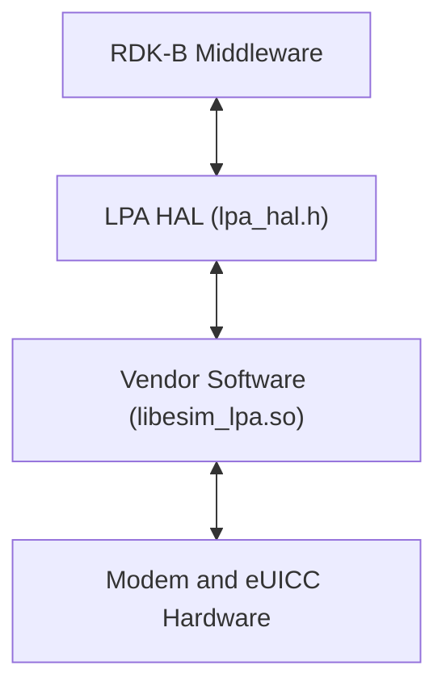
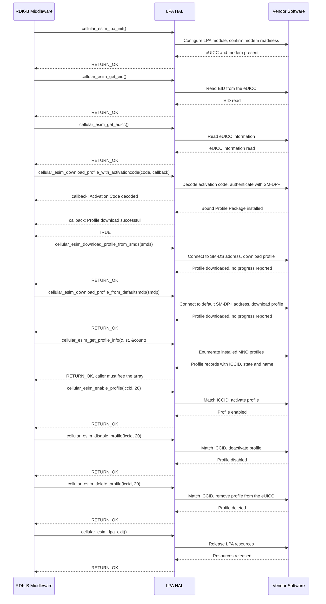

# LPA HAL Documentation

## Version History

| Date | Comment | Version |
| --- | --- | --- |
| 2024-05-24 | Initial release. LPA HAL interface header migrated to GitHub under RDKB-52499. | 1.0.0 |
| Not recorded | Maintenance release. Removed an unwanted character from the interface header. | 1.0.1 |
| 2026-08-24 | Specification rewritten against the interface header: the `eSIM` and `eUICC` subject matter corrected, the complete API surface documented, and the asynchronous notification, memory and error-handling contracts restated from the declarations. | Unreleased |

## Acronyms

- `HAL` \- Hardware Abstraction Layer
- `RDK-B` \- Reference Design Kit for Broadband Devices
- `OEM` \- Original Equipment Manufacturer
- `LPA` \- Local Profile Assistant
- `eSIM` \- Embedded Subscriber Identity Module
- `eUICC` \- Embedded Universal Integrated Circuit Card, the component an `eSIM` profile is installed onto
- `SIM` \- Subscriber Identity Module
- `UICC` \- Universal Integrated Circuit Card
- `USIM` \- Universal Subscriber Identity Module
- `EID` \- `eUICC` Identifier, the unique identifier of an `eUICC`
- `ICCID` \- Integrated Circuit Card Identification, the identifier of an individual profile
- `MNO` \- Mobile Network Operator
- `SM-DS` \- Subscription Manager Discovery Service
- `SM-DP+` \- Subscription Manager Data Preparation, the server that delivers a prepared profile
- `ITU-T` \- International Telecommunication Union, Telecommunication Standardization Sector
- `SLA` \- Service Level Agreement

## Description

The `LPA` (Local Profile Assistant) `HAL` is the `RDK-B` interface for `eSIM` **profile management on an `eUICC`**. It abstracts a vendor's Local Profile Assistant implementation so that `RDK-B` software can download, activate, deactivate, remove and enumerate `MNO` profiles, and read the identity of the `eUICC` itself, without depending on a particular modem, `eUICC` or `OEM` implementation.

The diagram below shows where the LPA HAL sits in the software stack.

No dedicated `RDK-B` middleware service owns this interface. The caller, shown as RDK-B Middleware, is whichever `RDK-B` component needs `eSIM` management, and it links the vendor library directly.

The interface covers five areas:

- **Profile download** \- installing a profile onto the `eUICC`, from an activation code, from an `SM-DS` address, or from a default `SM-DP+` address.
- **Profile lifecycle** \- enabling, disabling and permanently deleting an installed profile, each selected by its `ICCID`.
- **Profile inspection** \- enumerating the `MNO` profiles present on the `eUICC` with their `ICCID`, state and name.
- `eUICC` identity \- reading the `EID` and the `eUICC` information.
- **Module lifecycle** \- bringing the Local Profile Assistant up and tearing it down.

## Optional Components

This interface declares no optional build-time components: every declaration in `include/lpa_hal.h` is present in every build. Two forms of optionality are visible in the interface itself, and a caller plans for both:

- `cellular_esim_download_profile_with_activationcode()`, `cellular_esim_download_profile_from_smds()` and `cellular_esim_download_profile_from_defaultsmdp()` are **alternative** download paths, not a sequence. A deployment may use any one of them, and need not support all three.
- Download progress is reported on the activation-code path **only**; see `Asynchronous Notification Model`.

## Component Runtime Execution Requirements

The requirements in this block govern how an implementation behaves at run time and what a caller may rely on.

### Initialization and Startup

The Cellular `eSIM` `LPA` module requires no external API dependencies for initialization. `cellular_esim_lpa_init()` is **mandatory** and must be called before any other function in this interface.

- `cellular_esim_lpa_init()` \- brings the Local Profile Assistant up: configures the module, establishes modem readiness and sets up the dependencies and parameters the remaining operations need.
- `cellular_esim_lpa_exit()` \- deactivates the module and releases its resources. To be called before shutdown, or once `LPA` functionality is no longer needed.

Third-party vendors are responsible for providing a concrete implementation of `cellular_esim_lpa_init()`. That implementation must check that the necessary hardware — the `eUICC` and the modem — is present and functional, so that subsequent operations do not fail against missing or unprepared hardware.

### Threading Model

The interface is not required to be thread-safe. It is the responsibility of the calling module or component to ensure that all interactions with these APIs are properly synchronized.

Vendors may implement internal threading and event mechanisms to meet their operational requirements. Those mechanisms must ensure thread safety when interacting with this interface, and must guarantee cleanup of every resource they allocate — memory, file handles and threads — when the implementation terminates or the caller closes its use of the HAL.

A caller writes the body of `cellular_sim_download_progress_callback` to be safe on a thread it does not own, and serializes its own access to whatever that body touches.

### Process Model

All APIs are expected to be called from multiple processes. Because of this concurrent access, vendors must implement protection mechanisms within their implementations to handle multiple processes calling the same API simultaneously, so that data integrity is preserved, race conditions are prevented and the system remains stable.

### Memory Model

The caller owns every buffer it passes into this interface, and the only memory the interface hands back is the profile array returned by `cellular_esim_get_profile_info()`.

#### Caller Responsibilities

- **Free the profile array.** Release the array `cellular_esim_get_profile_info()` returns once that call has returned `RETURN_OK`, and before calling `cellular_esim_lpa_exit()`. After a failed call the output is undefined and is neither read nor freed.
- **Keep passed buffers valid.** Keep every buffer passed into a call allocated and unmodified for the duration of the call, and beyond it until the vendor has confirmed that the implementation does not retain the pointer; without that confirmation, hold the buffer until `cellular_esim_lpa_exit()` has returned.
- **Zero-terminate every string.** All strings passed across this interface must be zero-terminated, so that string functions can determine their length and buffer manipulation cannot overrun.

#### Module Responsibilities

- Allocate and deallocate memory for internal operations, and release all internally allocated memory on closure, so that repeated bring-up and tear-down does not leak.
- Keep the profile array returned by `cellular_esim_get_profile_info()` valid until the caller releases it.

### Power Management Requirements

The LPA HAL is not involved in any power management operation. It neither participates in nor requires involvement in power state transitions, wake event configuration or resource throttling, and it declares no API for any of them.

### Asynchronous Notification Model

This interface provides **exactly one** asynchronous channel: `cellular_sim_download_progress_callback`, declared as `int (*)(char *progress)` and installed as the second argument of `cellular_esim_download_profile_with_activationcode()`.

- **Installed per call.** There is no registration or deregistration API. The callback's scope is the download it was passed to, so a caller cannot install a standing notification handler and has nothing to unregister.
- **Activation-code path only.** `cellular_esim_download_profile_from_smds()` and `cellular_esim_download_profile_from_defaultsmdp()` take no callback argument and report no progress to the caller.
- **The callback returns a status.** It returns `RETURN_OK` when it accepts a message and an error otherwise. A caller does not use an error return to cancel a download.
- **Delivery context.** See `Threading Model`.

The `progress` argument carries one of the following status messages:

- `Activation Code decoded`
- `Initiate authentication done`
- `SM-DP+ address checking done`
- `Authenticate server done`
- `Authenticate client done`
- `PPR conditions check done`
- `Get Bound Profile Package done`
- `Send PIR notification to server done`
- `Clear PIR notification done`
- `Read pending notifications...`
- `<1> pending notification(s) detected`
- `Processing notification #1 <33>`
- `Notification <33> successfully sent`
- `Load Bound Profile Package done - Profile download successful`
- `download successful`

Two of those messages embed values that vary at run time — the pending notification count and the notification identifier — so a caller matches them on a prefix. A caller treats the list as a vocabulary, not as an ordered sequence in which every message appears.

### Blocking calls

- **Synchronous and responsive.** Every function returns its outcome directly as a status and is expected to complete within a time commensurate with the complexity of the operation requested.
- **Non-blocking requirement.** These APIs are called from a single-threaded context per caller, so an implementation must not block or suspend the calling thread: it avoids long-running work there, or performs that work asynchronously internally.
- **Network-facing downloads.** The three download functions contact a remote `SM-DP+` or `SM-DS` server, so their duration includes a network round trip.
- **Bring-up exception.** Where the `eUICC` or the modem is not yet available, `cellular_esim_lpa_init()` waits until the hardware becomes available. A caller therefore does not depend on it returning promptly at bring-up, and imposes and enforces its own bound where one is required.
- **Progress callback.** A callback body runs while the activation-code download is in progress, so it returns promptly and defers lengthy work to the caller's own context.

### Internal Error Handling

- **Synchronous error handling.** Every function in this interface returns `int` and reports failure through that return value, so a caller learns of an error immediately at the call site.
- **Internal error reporting.** The HAL is responsible for reporting internal system errors, such as an out-of-memory condition, through the return value.
- **Logging for errors.** For system errors an implementation also logs enough detail to make the cause identifiable without reproducing the failure. See `Logging and debugging requirements`.

| Macro | Value | Meaning |
| --- | --- | --- |
| `RETURN_OK` | `0` | Success for ten of the eleven functions. The operation completed and its documented post-conditions hold. |
| `RETURN_ERROR` | `-1` | Failure for those ten functions. The caller relies on no output parameter and looks to the vendor log for the cause. |
| `TRUE` | `1` | Success for `cellular_esim_download_profile_with_activationcode()`. |
| `FALSE` | `0` | Failure for `cellular_esim_download_profile_with_activationcode()`. The caller treats no profile as installed until enumeration confirms otherwise. |

Caller code compares against `RETURN_ERROR`; the spelling `RETURN_ERR` is not defined by this interface and does not compile.

- **The activation-code download uses a different convention, and the collision is silent.** Because `FALSE` and `RETURN_OK` are both `0`, **a caller that tests the result of `cellular_esim_download_profile_with_activationcode()` against `RETURN_OK` reads a documented failure as a success.** A caller treats a non-zero result from that function as success only once it has confirmed the convention with its vendor, and does not reuse the comparison that is correct for the other ten functions.
- **The status code is the only failure information.** `lpaGetErrorCodeDescription` and `lpaGetErrorCode` are not declared by this interface, so code written against them does not link.

### Persistence Model

There is no requirement for the HAL to persist any setting information. A caller is responsible for persisting anything its own implementation needs.

Installed profiles live on the `eUICC` and outlive the module: `cellular_esim_lpa_exit()` neither disables nor removes a profile, and only `cellular_esim_delete_profile()` removes one. A deletion is **permanent** and survives tear-down and any later bring-up.

## Non functional requirements

The following non-functional requirements apply to any implementation of this interface.

### Logging and debugging requirements

The LPA HAL component is required to record all errors and critical informative messages, so that a failure can be identified and the functional flow of the system understood after the fact. Logging should be implemented using the `syslog` method, which provides the capabilities suited to system-level software. The use of `printf` is discouraged unless `syslog` is not available.

All HAL components must adhere to a consistent logging process. When logging is necessary it should be written to the `lpa_vendor_hal.log` file, located in either the `/var/tmp/` or the `/rdklogs/logs/` directory.

Logs must be categorized according to the following log levels, as defined by the Linux standard logging system, listed here in descending order of severity:

- **FATAL:** Critical conditions, typically indicating system crashes or severe failures that require immediate attention.
- **ERROR:** Non-fatal error conditions that nonetheless significantly impede normal operation.
- **WARNING:** Potentially harmful situations that do not yet represent errors.
- **NOTICE:** Important but not error-level events.
- **INFO:** General informational messages that highlight system operations.
- **DEBUG:** Detailed information typically useful only when diagnosing problems.
- **TRACE:** Very fine-grained logging to trace the internal flow of the system.

Each log entry should include a timestamp, the log level and a message describing the event or condition. This standard format makes log files parseable and comparable across different vendors and components.

Implementations must not log credentials, secrets, security-sensitive information, or other sensitive data.

That rule applies at every log level, `DEBUG` and `TRACE` included, and to every diagnostic output: log files, `syslog`, standard output and standard error, traces, crash dumps, telemetry and error messages. A fragment, hash or length of a sensitive value is treated as the value itself. Where a diagnostic must refer to such a value, it records the operation and its outcome and substitutes the fixed marker `[REDACTED]` for the value. Callers apply the same rule to their own diagnostics.

### Memory and performance requirements

An implementation should not contribute disproportionately to memory or CPU utilization during normal operation, and its resource use should be commensurate with the operation requested. `cellular_esim_get_profile_info()` allocates on behalf of the caller, so its cost grows with the number of profiles installed on the `eUICC`.

### Quality Control

To ensure the highest quality and reliability, it is strongly recommended that third-party quality assurance tools such as `Coverity`, `Black Duck` and `Valgrind` be employed to analyze the implementation, so that memory leaks, memory corruption and similar defects are detected and resolved before deployment.

Both the HAL implementation and any software interacting with it must prioritize robust memory management: careful allocation, matching deallocation and explicit error handling, following the ownership rules under `Memory Model`.

Any change to a file listed under `Source References` obliges a review of this document. The responsible reviewer is the owner named in this repository's `.github/CODEOWNERS`, `@rdkcentral/rdkb-hal-advisory`.

This HAL is not available on the HUB6 or XER10 reference platforms, so the runtime behavior this document states rests on the interface definition and has not been exercised on reference hardware.

### Licensing

The LPA HAL implementation is expected to be released under the Apache License 2.0. The interface header carries that license notice, and the full text is available at the repository root as `LICENSE`, with `COPYING` and `NOTICE` alongside it.

### Build Requirements

The source code should be capable of, but not limited to, building under the Yocto distribution environment. The recipe should deliver a shared library named `libesim_lpa.so`.

### Variability Management

Changes to the interface are controlled by versioning. Vendors are expected to implement against a fixed version of the interface and, as `SLA` terms require, to move to later versions as demand dictates. Each API interface is versioned using [Semantic Versioning 2.0.0](https://semver.org/spec/v2.0.0.html), and vendor code complies with a specific version of the interface.

This interface has no compile-time variability (see `Optional Components`), and `include/lpa_hal.h` defines no interface version macro, so a caller cannot select an interface revision at compile time or at run time. The release tag is the only version identity.

### Platform or Product Customization

This interface defines no platform or product customization surface — no vendor extension point, product-specific macro or configuration file — so the same eleven declarations are presented to every caller on every platform. Product-specific behavior is confined to the vendor implementation behind the interface.

## Interface API Documentation

All HAL function prototypes and datatype definitions are available in the `lpa_hal.h` header file.

1. Components and processes must include `lpa_hal.h` to make use of LPA HAL capabilities.
2. Components and processes should add a linker dependency for `libesim_lpa.so`.

### Theory of operation and key concepts

The interface has one central concept: the `eSIM` profile, an operator subscription installed onto the `eUICC` and identified by its `ICCID`. Every operation either creates a profile, changes which profile is active, removes a profile, reports on the profiles present, or reports on the card that holds them.

#### Object Lifecycles

- **The profile.** A profile is created on the card by one of the three download functions, enumerated by `cellular_esim_get_profile_info()`, activated and deactivated by `cellular_esim_enable_profile()` and `cellular_esim_disable_profile()`, and permanently removed by `cellular_esim_delete_profile()`. Its `ICCID` is the only handle this interface offers for it.
- **The profile record.** `cellular_esim_get_profile_info()` returns a caller-owned array of `eSIMProfileStruct` describing the profiles found, together with a count. The array is a snapshot, so a caller that has enabled, disabled or deleted a profile, or brought the module up again, re-reads rather than reuses it.
- **The module.** `cellular_esim_lpa_init()` brings the Local Profile Assistant up and `cellular_esim_lpa_exit()` tears it down. Neither returns a handle or a context, so the module state is implicit and at most one instance of it is addressable through this interface.

#### Method Sequencing

- `cellular_esim_lpa_init()` **comes first**, before any other function in this interface, including `cellular_esim_get_eid()` and `cellular_esim_get_euicc()`.
- **Download before lifecycle.** A profile must have been downloaded, or already be present on the card, before `cellular_esim_enable_profile()`, `cellular_esim_disable_profile()` or `cellular_esim_delete_profile()` can succeed.
- **Inspect to obtain an `ICCID`.** `cellular_esim_get_profile_info()` is how a caller discovers the `ICCID` values it may pass to those three calls.
- `cellular_esim_lpa_exit()` **comes last**, before shutdown or once the functionality is no longer required.

**Download arguments.** The syntax of an activation code is fixed by the issuing party or the vendor implementation. The header illustrates the other two arguments with test endpoints rather than live operator infrastructure: an `SM-DS` address such as `oem-smds-json.demo.gemalto.com` and an `SM-DP+` address such as `smdp-plus.test.gsma.com`. The values a deployment uses arrive from provisioning at run time.

#### State-Dependent Behavior

- **Profile state.** The only state this interface exposes is `eSIMProfileStruct.profileState`; `State Diagram` gives its values and the effect of each lifecycle call on it.
- **Outcome depends on the card's contents.** All three lifecycle calls verify the supplied `ICCID` against the profiles stored on the card and fail when there is no match, so their outcome depends on what is installed rather than on a mode the interface exposes.
- **After download.** A caller that needs a newly downloaded profile enabled calls `cellular_esim_enable_profile()` explicitly rather than assuming the download left it active.

### Data Structures and Defines

The header organizes its public types and functions under the Doxygen groups `lpa_hal`, `LPA_HAL_TYPES` and `LPA_HAL_APIS`, so the generated reference presents the types and the functions on separate pages.

| Definition | Kind | Represents |
| --- | --- | --- |
| `eSIMProfileStruct` | struct | One `eSIM` profile as reported by the card. |
| `cellular_sim_download_progress_callback` | function pointer typedef | Progress notification during an activation-code download, installed by `cellular_esim_download_profile_with_activationcode()`; see `Asynchronous Notification Model`. |
| `CellularPreferredUICC_t` | enumeration | Which `UICC` type is preferred: a removable `USIM` or the `eUICC`. |
| `CellularDeviceSimStatus_t` | enumeration | Preparation status of a device `SIM`. |

`eSIMProfileStruct` is the only structure this interface defines, and it is populated by the implementation and read by the caller — never the other way round.

| Member | Type | Constraint | Meaning |
| --- | --- | --- | --- |
| `iccid` | `char[32]` | Value is a 20-digit string; the buffer is 32 bytes | Profile identifier, in the format of `ITU-T` Recommendation E.118. |
| `profileState` | `int` | `0` or `1` | Whether the profile is currently active: `0` disabled, `1` enabled. |
| `profileName` | `char[16]` | Zero-terminated | Human-readable operator name, for example `Xfinity Mobile`. |

The buffer sizes are the contract a caller must respect: a caller takes the `ICCID` length from the 20-digit contract rather than from the field size, and an operator name longer than the 16-byte field, terminator included, cannot be represented.

**Status macros.** `RETURN_ERROR` (`-1`), `RETURN_OK` (`0`), `TRUE` (`1`) and `FALSE` (`0`) are the values the functions return; `Internal Error Handling` gives the meaning of each. `TRUE` and `FALSE` are each defined only where the including translation unit has not already defined them.

**The two enumerations are not used by any function.** `CellularPreferredUICC_t` (`CELLULAR_UICC_USIM` = 0, `CELLULAR_UICC_ESIM`) and `CellularDeviceSimStatus_t` (`SIM_PREPARATION_PENDING` = 1, `SIM_PREPARATION_INPROGRESS`, `SIM_PREPARATION_DOWNLOADED`, `SIM_PREPARATION_DONE`) appear in no declared function signature, so a caller can construct their values but has nowhere in this interface to pass them.

### API Surface

This interface declares **eleven** functions, all listed below by exact identifier. Per-API detail — argument ranges, pre-conditions, every return value and what a caller should do about each — is carried by the Doxygen block on each declaration in `include/lpa_hal.h`.

**Module lifecycle:**

| API | Purpose |
| --- | --- |
| `cellular_esim_lpa_init` | Initializes the Local Profile Assistant, establishes modem readiness and sets up the parameters the other operations need. Mandatory before any other call. |
| `cellular_esim_lpa_exit` | Deactivates the module and releases its resources. |

**Profile download:**

| API | Purpose |
| --- | --- |
| `cellular_esim_download_profile_with_activationcode` | Downloads and installs a profile from an activation code, reporting progress through a caller-supplied callback. |
| `cellular_esim_download_profile_from_smds` | Downloads a profile by connecting to a specified `SM-DS` address. Reports no progress. |
| `cellular_esim_download_profile_from_defaultsmdp` | Downloads a profile from a default `SM-DP+` address. Reports no progress. |

**Profile lifecycle:**

| API | Purpose |
| --- | --- |
| `cellular_esim_enable_profile` | Activates the profile whose `ICCID` matches the one supplied. |
| `cellular_esim_disable_profile` | Deactivates the profile whose `ICCID` matches the one supplied. |
| `cellular_esim_delete_profile` | Permanently removes the profile whose `ICCID` matches the one supplied. |

**Profile inspection:**

| API | Purpose |
| --- | --- |
| `cellular_esim_get_profile_info` | Retrieves the `MNO` profiles present on the card as a callee-allocated, caller-freed array, with a count. |

`eUICC` **and `EID` information:**

| API | Purpose |
| --- | --- |
| `cellular_esim_get_eid` | Retrieves the `EID` of the device's `eSIM`. |
| `cellular_esim_get_euicc` | Retrieves information about the `eUICC`. |

`cellular_esim_get_eid()` and `cellular_esim_get_euicc()` are each declared with an **empty parameter list** and return only a status code, so they hand no `EID` or `eUICC` information back to the caller through this interface.

### Sequence Diagram

The exchange below walks the whole interface in a valid order, from bring-up to tear-down, using the real identifiers.

The three download calls are alternative paths, and the three profile lifecycle calls are shown consecutively only to name each one; neither order is a requirement, and `Method Sequencing` gives the required ordering. The `TRUE` return on the activation-code path is that declaration's documented convention; see `Internal Error Handling`.

### State Diagram

`eSIMProfileStruct.profileState` is the only state any declaration reports. The interface documents its two values and the effect of each successful lifecycle call, but no transitions between the values, so the diagram shows the two documented states without edges.

| Operation | Documented effect of success |
| --- | --- |
| `cellular_esim_enable_profile` | The named profile is active, and a subsequent `cellular_esim_get_profile_info()` reports its `profileState` as `1`. |
| `cellular_esim_disable_profile` | The named profile is no longer active and reports `profileState` as `0`. It remains installed — disabling is not deletion. |
| `cellular_esim_delete_profile` | The profile is removed from the card permanently and no longer appears in `cellular_esim_get_profile_info()`. |
| the three download functions | A profile has been downloaded or its download initiated; the profile inventory confirms what is on the card. |

A caller relies on the meanings of `0` and `1` and on the documented effect of each successful call. It treats any other value as an unknown state, re-reading the inventory rather than mapping the value onto enabled or disabled or acting on it. `cellular_esim_lpa_init()` and `cellular_esim_lpa_exit()` change whether the module is usable, not the value of `profileState`; tear-down leaves installed profiles unchanged (see `Persistence Model`).

`CellularDeviceSimStatus_t` (see `Data Structures and Defines`) and the download progress messages (see `Asynchronous Notification Model`) are not profile states and are not drawn.

## Source References

- [rdkcentral/rdkb-halif-lpa/include/lpa_hal.h](https://github.com/rdkcentral/rdkb-halif-lpa/blob/develop/include/lpa_hal.h) — interface header: declarations, types, status codes and per-API documentation
- [rdkcentral/rdkb-halif-lpa/CHANGELOG.md](https://github.com/rdkcentral/rdkb-halif-lpa/blob/develop/CHANGELOG.md) — release history behind `Version History`
- [rdkcentral/rdkb-halif-lpa/LICENSE](https://github.com/rdkcentral/rdkb-halif-lpa/blob/develop/LICENSE) — Apache License 2.0 text
- [rdkcentral/rdkb-halif-lpa/.github/CODEOWNERS](https://github.com/rdkcentral/rdkb-halif-lpa/blob/develop/.github/CODEOWNERS) — responsible reviewer named under `Quality Control`

