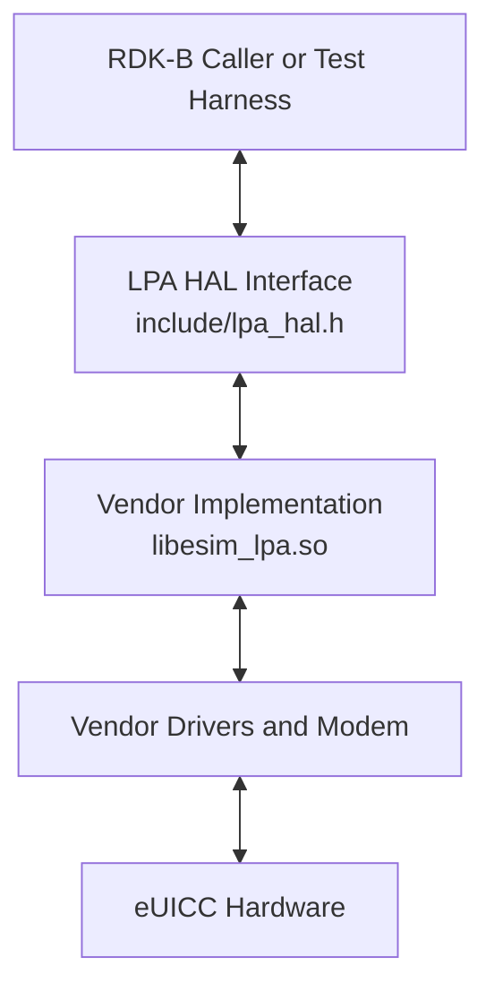
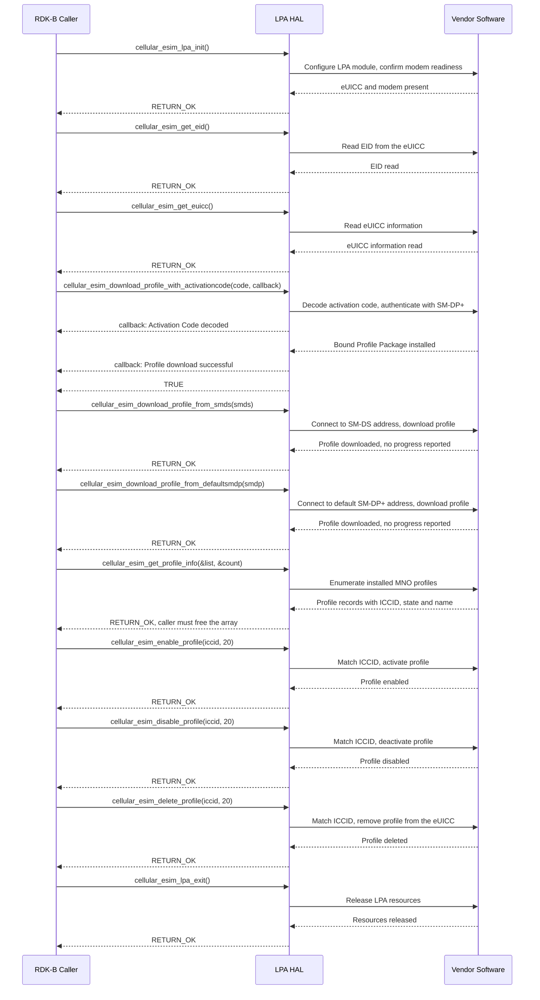

# LPA HAL Documentation

## Version History

| Date | Comment | Version |
| --- | --- | --- |
| 2024-05-24 | Initial release. LPA HAL interface header migrated to GitHub under RDKB-52499. | 1.0.0 |
| Not recorded | Maintenance release. Removed an unwanted character from the interface header. | 1.0.1 |
| 2026-08-24 | Specification rewritten against the interface header: the `eSIM` and `eUICC` subject matter corrected, the complete API surface documented, and the asynchronous notification, memory and error-handling contracts restated from the declarations. | Unreleased |

**Provenance of this page.** It was renamed from `docs/pages/LpaHalSpec.md` to `docs/pages/halSpec.md` in the same change that rewrote it against the canonical topic set. Git records a rename only where the two versions still resemble each other, and a full rewrite does not, so `git log --follow -- docs/pages/halSpec.md` begins at that change: the revisions before it are reached with `git log -- docs/pages/LpaHalSpec.md`. That resemblance is measured, and the threshold is 50% by default, so lowering it to git's floor \- `git log --follow -M1% -- docs/pages/halSpec.md` \- is worth trying first: where it pairs the two paths it shows both stretches of history in one listing, and where the rewrite kept too little of the original for git to pair them at any threshold the second command above remains the only route to the earlier revisions.

Four version identities apply to this component, and this document keeps them apart deliberately, because they do not share a value:

- **Document revision** \- the `Version` column above. The rewrite recorded in the last row is not yet covered by a release tag, so it is marked `Unreleased` rather than given a number this repository has not issued. The `1.0.1` release carries no date in `CHANGELOG.md`, so none is stated for it here.
- **Interface version** \- `include/lpa_hal.h` defines **no** interface version macro. There is no constant a caller can test, at compile time or at run time, to discover which revision of this interface it is building against. See `Variability Management`.
- **Release tag** \- the nearest tag is `1.0.1`. This repository carries exactly two tags, `1.0.0` and `1.0.1`.
- **Generated-site version string** \- `docs/generate_docs.sh` derives `PROJECT_VERSION` from `git describe --tags` and passes it to the documentation generator, so the title of the generated site carries a string of the form `1.0.1-<commits>-g<abbreviated-commit>`. That is the nearest tag plus the number of commits made since it, and it advances with every commit; it is a build label and **not** a version of either the interface or this document. A reader comparing two generated sites should compare the tag portion and treat the suffix as a build coordinate.

*Derived from `CHANGELOG.md`, this repository's tag list, `include/lpa_hal.h` and `docs/generate_docs.sh`.*

## Acronyms

- `HAL` \- Hardware Abstraction Layer
- `RDK-B` \- Reference Design Kit for Broadband Devices
- `OEM` \- Original Equipment Manufacturer
- `LPA` \- Local Profile Assistant
- `eSIM` \- Embedded Subscriber Identity Module
- `eUICC` \- Embedded Universal Integrated Circuit Card, the component an `eSIM` profile is installed onto
- `UICC` \- Universal Integrated Circuit Card
- `USIM` \- Universal Subscriber Identity Module
- `EID` \- `eUICC` Identifier, the unique identifier of an `eUICC`
- `ICCID` \- Integrated Circuit Card Identification, the identifier of an individual profile
- `MNO` \- Mobile Network Operator
- `SM-DS` \- Subscription Manager Discovery Service
- `SM-DP+` \- Subscription Manager Data Preparation, the server that delivers a prepared profile
- `ITU-T` \- International Telecommunication Union, Telecommunication Standardization Sector
- `SLA` \- Service Level Agreement

*The expansions of `UICC`, `USIM`, `eUICC`, `EID` and `ICCID` are taken from the declaration comments in `include/lpa_hal.h`; the remainder are the terms this document itself uses.*

## Description

The `LPA` (Local Profile Assistant) `HAL` is the `RDK-B` interface for **`eSIM` profile management on an `eUICC`**. It abstracts a vendor's Local Profile Assistant implementation so that `RDK-B` software can download, activate, deactivate, remove and enumerate `MNO` profiles, and read the identity of the `eUICC` itself, without depending on a particular modem, `eUICC` or `OEM` implementation.

The diagram below illustrates the high-level software architecture of the LPA HAL module stack, demonstrating how it fits within the broader system context.

**No dedicated `RDK-B` middleware service owns this interface.** Most HALs in this corpus are driven by a single owning service, and the caller of the HAL is that service; the `RDK-B` inventory records no such service for `LPA`. The caller is therefore whichever `RDK-B` component or test harness needs `eSIM` management, and it links the vendor library directly. There is consequently no service to stop before exercising this interface, and no service whose state a caller must take into account.

The interface covers five things, and nothing else:

- **Profile download** \- installing a profile onto the `eUICC`, from an activation code, from an `SM-DS` address, or from a default `SM-DP+` address.
- **Profile lifecycle** \- enabling, disabling and permanently deleting an installed profile, each selected by its `ICCID`.
- **Profile inspection** \- enumerating the `MNO` profiles present on the `eUICC` with their `ICCID`, state and name.
- **`eUICC` identity** \- reading the `EID` and the `eUICC` information.
- **Module lifecycle** \- bringing the Local Profile Assistant up and tearing it down.

Earlier revisions of this document described this component as an interface for managing device power states, with narrative about wake events, resource control and battery life. That description was incorrect: no declaration in `include/lpa_hal.h` concerns power management, and the whole of the declared surface is `cellular_esim_*` profile and `eUICC` management. The description has been rewritten from the header. The one accurate power-related statement, that this HAL takes no part in power management, is retained under `Power Management Requirements`.

*Derived from `include/lpa_hal.h` (the complete declared surface, lines 136-1195) and the `RDK-B` superproject `README.md` (component summary and the absence of an owning service). Where the two differed, the header governed.*

## Optional Components

This interface declares no optional build-time components. There is no feature macro, configuration flag or conditional block that adds or removes any part of it, so every declaration in `include/lpa_hal.h` is present in every build. Two forms of optionality are nonetheless visible in the interface itself, and a caller should plan for both:

- `cellular_esim_download_profile_with_activationcode()`, `cellular_esim_download_profile_from_smds()` and `cellular_esim_download_profile_from_defaultsmdp()` are **alternative** download paths, not a sequence. A deployment may use any one of them, and need not support all three.
- Download progress reporting is available on the activation-code path **only**. `cellular_sim_download_progress_callback` is accepted by `cellular_esim_download_profile_with_activationcode()` and by no other function, so the other two download paths report no intermediate progress at all. This interface does not state whether the callback argument may be omitted.

*Derived from `include/lpa_hal.h` lines 338 (the callback typedef) and 468, 547 and 626 (the three download declarations).*

## Component Runtime Execution Requirements

The requirements in this block govern how an implementation behaves at run time and what a caller may rely on. Where this interface does not establish a behavior, that is stated explicitly rather than filled in, because a caller that assumes an unstated behavior, or a test that asserts one, will be wrong on some vendor implementation.

### Initialization and Startup

The Cellular `eSIM` `LPA` module requires no external API dependencies for initialization. `cellular_esim_lpa_init()` configures the module, establishes modem readiness and sets up the dependencies and parameters the remaining operations need. It is **mandatory** and must be called before any other function in this interface.

- `cellular_esim_lpa_init()` \- brings the Local Profile Assistant up. Takes no arguments and returns a status.
- `cellular_esim_lpa_exit()` \- deactivates the module and releases its resources. To be called before shutdown, or once `LPA` functionality is no longer needed.

Neither call returns a handle or context, so the module state is implicit: a caller cannot address more than one instance of it through this interface, and cannot pass an instance to another component.

Third-party vendors are responsible for providing a concrete implementation of `cellular_esim_lpa_init()`. That implementation must check that the necessary hardware — the `eUICC` and the modem — is present and functional, so that subsequent operations do not fail against missing or unprepared hardware.

Whether that check may **block** is contested by this specification's own history and is not settled by the interface. `Blocking calls` states the conflict in full; the outcome for a caller is that it must not assume either behavior from `cellular_esim_lpa_init()`.

*Derived from `include/lpa_hal.h` lines 1001-1039 and 1041-1087 (the two lifecycle blocks) and from this repository's previous specification revision, whose vendor obligations are retained.*

### Threading Model

The interface is not required to be thread-safe. It is the responsibility of the calling module or component to ensure that all interactions with these APIs are properly synchronized.

Vendors may implement internal threading and event mechanisms to meet their operational requirements. Those mechanisms must ensure thread safety when interacting with this interface, and must guarantee cleanup of every resource they allocate — memory, file handles and threads — when the implementation terminates or the caller closes its use of the HAL.

One gap matters to a caller and is stated rather than guessed: this interface does not specify which thread `cellular_sim_download_progress_callback` is invoked on, nor whether it may be invoked concurrently with the download call that installed it. A caller must therefore treat its callback body as though it may run on a thread it does not own.

*Derived from `include/lpa_hal.h` lines 280-338 (the callback and its unspecified thread) and from this repository's previous specification revision, which stated the thread-safety position.*

### Process Model

All APIs are expected to be called from multiple processes. Because of this concurrent access, vendors must implement protection mechanisms within their implementations to handle multiple processes calling the same API simultaneously. This is necessary to preserve data integrity, prevent race conditions and maintain the stability of the system.

This is compatible with the single-threaded expectation stated under `Blocking calls`: the two constrain different things. Several processes may hold this interface at once, while each individual caller is expected to drive it from one thread and therefore to need calls that return rather than suspend.

*Derived from this repository's previous specification revision.*

### Memory Model

#### Caller Responsibilities

- **Free the profile array.** `cellular_esim_get_profile_info()` allocates the profile data it returns, and the caller must release that memory. This is the only allocation this interface hands to the caller, and it is stated on the declaration itself: *"The caller must free the dynamically allocated memory for profile data."*
- **Own every buffer passed in, and do not reclaim it the moment the call returns.** The activation code, the `SM-DS` address, the `SM-DP+` address and the `ICCID` are all caller-supplied `char` buffers. The caller allocates them and keeps them valid for at least the duration of the call. **This interface does not state whether an implementation may retain a pointer beyond the call that received it**, so a buffer stays allocated and unmodified until the caller has established — by inspection of the implementation it integrates, or by contract with its supplier — either that the pointer is not retained or that the operation it was passed to has completed. Releasing, reusing or overwriting it belongs immediately after that point and not before, because an implementation that did retain the pointer may still be reading through it. A caller that can establish neither holds the buffer until it tears the module down. Where the buffer holds a protected value, `Logging and debugging requirements` states the overwrite obligation that this ordering governs, and states it in the same order.
- **Zero-terminate every string.** All strings passed across this interface must be zero-terminated, so that string functions can determine their length and so that buffer manipulation cannot overrun.
- **Respect the `ICCID` length contract.** `cellular_esim_enable_profile()`, `cellular_esim_disable_profile()` and `cellular_esim_delete_profile()` each take an `ICCID` documented as a 20-digit string together with its length, documented as 20. The `iccid` field of `eSIMProfileStruct` is a 32-byte buffer, so the buffer is larger than the value it carries; a caller must not infer the value length from the field size.

#### Module Responsibilities

- Allocate and deallocate memory for internal operations, and release all internally allocated memory on closure, so that repeated bring-up and tear-down does not leak.
- Keep the profile array returned by `cellular_esim_get_profile_info()` valid until the caller releases it.
- This interface does not state whether that array is invalidated by a subsequent `cellular_esim_lpa_exit()`. A caller that cannot tolerate either behavior should release the array before tearing the module down.

All implementations and all caller code must adhere to these requirements unless a specific declaration states otherwise in its own documentation. No memory footprint requirement is stated by this interface; see `Memory and performance requirements`.

*Derived from `include/lpa_hal.h` lines 660-669 and 695-700 (the allocation and its unnamed deallocator), lines 743-757, 830-844 and 914-928 (the `ICCID` parameters) and lines 234-239 (`eSIMProfileStruct`).*

### Power Management Requirements

The LPA HAL is not involved in any power management operation. It neither participates in nor requires involvement in power state transitions, wake event configuration or resource throttling, and it declares no API for any of them.

*Derived from this repository's previous specification revision, corroborated against `include/lpa_hal.h`, which declares no power management function.*

### Asynchronous Notification Model

This interface provides **exactly one** asynchronous channel: a download progress callback. Earlier revisions of this document stated that there were no asynchronous notifications at all, which the header contradicts.

`cellular_sim_download_progress_callback` is declared as `int (*)(char *progress)`. It is installed as the second argument of `cellular_esim_download_profile_with_activationcode()`, and by no other means. Four properties of that arrangement matter to a caller:

- **There is no registration or deregistration API.** The callback is passed per call, so its scope is the download it was passed to. A caller cannot install a standing notification handler, and has nothing to unregister.
- **Two of the three download paths report nothing.** `cellular_esim_download_profile_from_smds()` and `cellular_esim_download_profile_from_defaultsmdp()` take no callback argument, so their progress is not reported to the caller.
- **The callback returns a status.** Its return value is documented as `RETURN_OK` on successful progress reporting and an error otherwise, so an implementation expects a status back from the caller for each message it delivers. This interface does not state what an implementation does with a failure returned from the callback, so a caller must not assume that returning an error cancels the download.
- **The delivery context is unspecified.** See `Threading Model`.

The `progress` argument carries a status message. The declarations enumerate the following values, identically on the typedef and on the download function:

- `Activation Code decoded`
- `Initiate authentication done`
- `SM-DP+ address checking done`
- `Authenticate server done`
- `Authenticate client done`
- `PPR conditions check done`
- `Get Bound Profile Package done`
- `Send PIR notification to server done`
- `Clear PIR notification done`
- `Read pending notifications...`
- `<1> pending notification(s) detected`
- `Processing notification #1 <33>`
- `Notification <33> successfully sent`
- `Load Bound Profile Package done - Profile download successful`
- `download successful`

Two of those strings embed values that vary at run time — the pending notification count and the notification identifier — so a caller matching on them must match on a prefix rather than on the whole string. This interface does not state the order in which the messages are delivered, nor that every message appears in every download, so a caller must not treat the list as a sequence.

*Derived from `include/lpa_hal.h` lines 280-338 (the typedef and its documented values) and lines 495, 574 and 653 (which download functions accept a callback).*

### Blocking calls

**Synchronous and responsive.** All functions in this interface return a status directly and are expected to complete within a time commensurate with the complexity of the operation requested.

**A stated conflict on `cellular_esim_lpa_init()`.** This specification has made two mutually exclusive claims about that function: that it must block further execution until the required hardware becomes available, and that no function in this interface may block or suspend execution. Both were statements of this repository's specification rather than of the interface definition, and `include/lpa_hal.h` establishes neither. **This interface therefore does not establish whether `cellular_esim_lpa_init()` may block, and a caller must not assume either behavior.**

**Network-facing operations.** The three download functions contact a remote server — an `SM-DP+` or an `SM-DS` — as part of their work. That makes their duration dependent on a network round trip rather than on local computation. Even so, this interface does not specify whether `cellular_esim_download_profile_with_activationcode()`, `cellular_esim_download_profile_from_smds()` or `cellular_esim_download_profile_from_defaultsmdp()` may block; a caller must not assume either behavior.

**Timeout handling.** No timeout requirement is specified for this interface. Neither `include/lpa_hal.h` nor any other file in this repository states a completion-time target, an upper bound or a recommended timeout for any of these functions, and there is no per-API timeout documentation to refer to. A caller that needs a bound must impose and enforce its own.

**Single-threaded callers.** These APIs are expected to be called from a single-threaded context per caller, which is why an implementation must avoid long-running work on the calling thread wherever it can, or perform that work asynchronously internally.

*Derived from `include/lpa_hal.h` lines 495, 574 and 653 (the server-facing download paths) and from the two conflicting statements in this repository's previous specification revision.*

### Internal Error Handling

- **Synchronous error handling.** Every function in this interface returns `int` and reports failure through that return value, so a caller learns of an error immediately at the call site. No function reports failure by any other route.
- **Internal error reporting.** The HAL is responsible for reporting internal system errors, such as an out-of-memory condition, through the return value.
- **Logging for errors.** For system errors an implementation should also log the error detail, so that a failure can be investigated after the fact. See `Logging and debugging requirements`.

The interface defines two status codes:

| Macro | Value | Meaning |
| --- | --- | --- |
| `RETURN_OK` | `0` | The operation succeeded. |
| `RETURN_ERROR` | `-1` | The operation failed. |

Three properties of the error contract are defects rather than features, and a caller needs all three:

1. **`RETURN_ERR` does not exist.** Earlier revisions of the documentation comments in `include/lpa_hal.h` named a failure code `RETURN_ERR` on all eleven declarations. No such macro is defined by this interface or by anything it includes, so caller code written against `RETURN_ERR` does not compile. Those comments now name `RETURN_ERROR`, which is the defined failure code and the one a caller compares against; the header retains a single warning recording the old spelling, so that a caller who met it in an earlier revision can see why it never resolved.
2. **One function documents an incompatible convention, and the collision is silent.** `cellular_esim_download_profile_with_activationcode()` documents `TRUE` for success and `FALSE` for failure, where the other ten functions document `RETURN_OK` and `RETURN_ERROR`. Because `FALSE` and `RETURN_OK` are both `0`, **a caller that tests that one function's result against `RETURN_OK` reads a documented failure as a success.** The interface does not resolve which convention an implementation actually follows, so a caller must not assume: treat a non-zero result from that function as success only if it has confirmed the convention with its vendor, and do not reuse the comparison that is correct for the other ten.
3. **There is no error-code retrieval API.** The declaration of the activation-code download directs a caller to obtain detail through `lpaGetErrorCodeDescription` and `lpaGetErrorCode`. **Neither of those two functions is declared in this repository**, by that header or any other, so the mechanism they imply is not part of this interface and a caller cannot rely on it. The status code is the only failure information this interface defines.

*Derived from `include/lpa_hal.h` lines 201-212 (the four status macros), lines 98-109 (the interface-wide warnings on the absent `RETURN_ERR` spelling and the divergent convention), lines 248-271 (the interface-wide error contract) and lines 412-443 (the divergent convention and the undeclared retrieval functions on the activation-code declaration).*

### Persistence Model

There is no requirement for the HAL to persist any setting information. A caller is responsible for persisting anything its own implementation needs.

The profiles this interface manages are a separate matter, and what can be said about them is narrower than it looks. One thing is established: `cellular_esim_delete_profile()` is documented to remove a profile **permanently**, so a deletion is not something a caller can expect to be undone.

**Whether an installed profile survives tear-down, process exit or a device restart is not specified by this interface.** `cellular_esim_lpa_exit()` is documented to deactivate the module and release its resources — the *module's* resources — and nothing in `include/lpa_hal.h`, in this repository's previous specification revision or in any other file here states that installed profiles persist beyond it, or that they are discarded. A caller must therefore assume neither. Where it needs to know what is on the card after a later `cellular_esim_lpa_init()`, it re-reads the inventory with `cellular_esim_get_profile_info()` rather than relying on a snapshot taken before the exit, and a test must not assert either outcome. An earlier revision of this page asserted that profile state "outlives any single lifetime of the HAL module"; the interface does not establish that, so the claim is withdrawn rather than restated more carefully.

*Derived from `include/lpa_hal.h` lines 909-999 (permanent deletion) and lines 1049-1063 (the `@post` of tear-down, which covers the module's resources and says nothing about installed profiles), and from this repository's previous specification revision, which states only that the HAL is not required to persist setting information. The absence of a persistence guarantee is derived from the absence of any statement of one anywhere in this repository.*

## Non functional requirements

The following non-functional requirements apply to any implementation of this interface.

### Logging and debugging requirements

The LPA HAL component is required to record all errors and critical informative messages, so that a failure can be identified and the functional flow of the system understood after the fact. Logging should be implemented using the `syslog` method, which provides the capabilities suited to system-level software. The use of `printf` is discouraged unless `syslog` is not available.

All HAL components must adhere to a consistent logging process. When logging is necessary it should be written to the `lpa_vendor_hal.log` file, located in either the `/var/tmp/` or the `/rdklogs/logs/` directory.

Logs must be categorized according to the following log levels, as defined by the Linux standard logging system, listed here in descending order of severity:

- **FATAL:** Critical conditions, typically indicating system crashes or severe failures that require immediate attention.
- **ERROR:** Non-fatal error conditions that nonetheless significantly impede normal operation.
- **WARNING:** Potentially harmful situations that do not yet represent errors.
- **NOTICE:** Important but not error-level events.
- **INFO:** General informational messages that highlight system operations.
- **DEBUG:** Detailed information typically useful only when diagnosing problems.
- **TRACE:** Very fine-grained logging to trace the internal flow of the system.

Each log entry should include a timestamp, the log level and a message describing the event or condition. This standard format makes log files parseable and comparable across different vendors and components.

Because the status code is the only failure information this interface defines (see `Internal Error Handling`), the log is the only place a caller can look for the reason behind a failure. An implementation should log enough detail on failure to make the cause identifiable without reproducing it.

**Subscriber identifiers and download credentials must not be logged.** This interface is keyed on the very identifiers that name a subscriber to a mobile network, so the rule is normative rather than advisory and it binds the vendor implementation and the RDK-B caller equally. The obligation is stated here because the interface declares no redaction helper, no sensitivity marker and no secure-buffer type, so nothing enforces it mechanically.

- **The protected values, named exactly.** The `ICCID` that `cellular_esim_enable_profile`, `cellular_esim_disable_profile` and `cellular_esim_delete_profile` each take as an argument, and that `cellular_esim_get_profile_info` returns in the `iccid` field of every `eSIMProfileStruct`; the `EID` that `cellular_esim_get_eid` reports; the `eUICC` information that `cellular_esim_get_euicc` reports; and the activation code that `cellular_esim_download_profile_with_activationcode` takes. An `ICCID` and an `EID` identify a subscription and a card respectively and are personal data, and an activation code is single-use credential material that authorises a profile download. Those four are the protected set; every rule below applies to each of them.
- **The prohibition follows the value into every derivative of it.** What must not appear is not only the value but **any fragment, hash or length of it** — a leading or trailing portion, a first-and-last-character form, a character or digit count, a checksum, a `Luhn` remainder, a cryptographic or non-cryptographic digest, an encrypted or `Base64`-encoded rendering, and any other transformation from which the value can be recognised, narrowed or reconstructed. An `ICCID` is a structured identifier under `ITU-T` Recommendation `E.118`, so a leading fragment discloses the issuer and a trailing fragment narrows the subscriber; a length narrows a search; a hash is a stable identifier for the value it was taken from and lets two records be linked to one subscriber. Truncation and hashing are therefore not redaction, and a rule that permits either permits the disclosure.
- **No protected value, and no derivative of one, reaches any sink, at any severity.** The prohibited sinks are, exhaustively: the vendor log `lpa_vendor_hal.log` and every other log file; `syslog`; standard output and standard error; any other stream, socket or pipe an implementation or a caller writes diagnostics to; a trace buffer, an instrumentation trace or a function-entry trace; and any error message, whether returned to a caller, rendered for an operator or passed to a peer or a remote logging service. This holds at **every** level of the severity ladder above, `DEBUG` and `TRACE` included: a value too sensitive to appear at `INFO` is not made acceptable by lowering the severity, and a verbose or development build must not become a build that discloses subscriber identity. The `cellular_sim_download_progress_callback` vocabulary is a diagnostic stream for this purpose too — it describes progress and must not be extended with the credential or the identifier that produced it.
- **Crash artefacts, support bundles and telemetry are separate sinks, and each one fails separately.** No **core dump, minidump, heap dump, stack dump, stack trace or exception report** may carry a protected value or a derivative of one, and neither may a **support, diagnostic or field-collection bundle**, nor any **telemetry, analytics, metric, metric label, counter dimension or usage report**. This obligation is independent of the logging rule and is broken independently: an implementation with disciplined log statements still discloses everything if its crash handler uploads an unfiltered core, or if it labels a metric with an `ICCID` to make a dashboard per subscriber. Where a platform's crash handler cannot be constrained, the value must not be resident when an artefact could be taken, which is what the clearing rule below achieves.
- **One fixed, value-independent redaction marker: `[REDACTED]`.** Where a diagnostic must refer to a protected value, it records the operation and its outcome and substitutes the literal marker `[REDACTED]` for the value — the same marker for every one of the four protected values, of a form and a length that do not vary with the value it replaces, so that nothing about the value can be inferred from the marker. A record that needs to distinguish two profiles within one diagnostic uses the profile's index in the `eSIMProfileStruct` array `cellular_esim_get_profile_info` returned, which is a position rather than an identity. This marker is a *logging* convention and is distinct from the schematic placeholders this documentation and `include/lpa_hal.h` use when showing the *shape* of an activation code or an address; see `Theory of operation and key concepts`.
- **Caller-owned storage is overwritten in place, and *when* it is overwritten depends on where the storage came from.** Releasing an allocation is not clearing it: freed memory is reusable memory and its contents survive until something else writes over them, so storage that has held a protected value is overwritten in place first and released afterwards. Three cases differ in the moment at which that overwrite is safe, and a caller must not collapse them into one rule:
  - *Storage the caller allocated itself and never passed across this interface* — a working copy of an `ICCID`, an `EID`, `eUICC` information or an activation code — is overwritten as soon as the caller has finished with it, on **every** path including the failure path. A failed download, a failed read or a partially completed enumeration may have left part of a value in such a buffer, and nothing but the caller will clear it.
  - *A buffer the caller passed in* — the `ICCID` given to `cellular_esim_enable_profile()`, `cellular_esim_disable_profile()` or `cellular_esim_delete_profile()`, or the activation code given to `cellular_esim_download_profile_with_activationcode()` — is kept allocated and unmodified until the caller has established that the implementation does not retain the pointer, or that the operation it was passed to has completed, and is then overwritten immediately. This interface does not rule retention out (`Memory Model`), so an overwrite timed to the moment the call returns may corrupt a read a retaining implementation is still making; waiting until non-retention, release or completion is established and then clearing without further delay is the only order in which the two obligations are compatible. Establishing it by inspection or by contract is part of integrating a vendor implementation, and a caller that cannot establish it holds the buffer until it tears the module down and clears it then.
  - *Storage this interface returned* — the `eSIMProfileStruct` array from `cellular_esim_get_profile_info()` — is the caller's **only after that call has returned success**, which is the point at which ownership transfers. On success the caller overwrites the whole array in place and then releases it, on every path by which it finishes with the array, including a path where its own later processing failed part-way and including tear-down. On failure it does neither, for the reason in the next bullet.
- **A failed call leaves nothing to clear and nothing that may be touched.** `cellular_esim_get_profile_info()` defines neither output on failure — see the `@post` on that declaration in [`include/lpa_hal.h`](../../include/lpa_hal.h) — so `*profile_list` may hold an uninitialised value, a stale value or a partially written pointer. Dereferencing it to overwrite the records, or handing it to a deallocator, is a use of an undefined pointer, and it would be caused by the clearing rule rather than prevented by it. A caller therefore does not read, clear, overwrite or release the returned array after a failed call; it confines its clearing to storage it allocated and initialised itself, which is safe on every path precisely because the caller knows what is in it. Initialising both the pointer and the count to a known value before the call is what lets a caller tell the two paths apart afterwards.
- **A protected value has no second home.** It must not be copied into longer-lived storage — a data-model cache, a configuration file, an environment variable, a message queue or a retry buffer — and must not be passed to a component that has no need of it, because each copy is another buffer that has to be cleared and another sink that can leak. The interface defines no free, clear or scrub operation, so all of this is the caller's own responsibility; the per-declaration `@warning` blocks in [`include/lpa_hal.h`](../../include/lpa_hal.h) state the same obligations, in the same order, at each call site.
- **The absence of a granular error code does not license logging the input.** Where a call fails and the status value is the only information available (`Internal Error Handling`), the temptation is to log the argument that failed so that the failure can be diagnosed, and that is the single most likely way these rules get broken. The diagnostic records that the operation failed and on which profile index, never the identifier that was passed and never a fragment of it.
- **The interface guarantees none of this.** It declares no scrubbing function, no opaque credential type, no sensitivity annotation and no flag by which a caller could ask an implementation to suppress its own logging, and it gives a caller no way to verify that an implementation observes these rules. A caller integrating a vendor implementation must therefore establish compliance by inspection or by contract, and must treat the absence of subscriber identity from a vendor log, core file or telemetry feed as unverified until it has done so.

*Derived from this repository's previous specification revision (the log file, the severity ladder and the logging obligations); the protected set and the per-call-site obligations are derived from the `@warning` blocks on the declarations in [`include/lpa_hal.h`](../../include/lpa_hal.h), which carry the same rule at each call site.*

### Memory and performance requirements

An implementation should not contribute disproportionately to memory or CPU utilization during normal operation, and its resource use should be commensurate with the operation requested.

**No memory footprint limit is specified for this interface.** Neither `include/lpa_hal.h` nor any other file in this repository states a maximum resident size, a heap ceiling or an allocation budget for an implementation, so neither a caller nor an integrator may assume one, and a test must not assert one. The same is true of completion time: see `Blocking calls`.

Two performance-relevant properties do follow from the declarations and are worth planning around. The three download functions depend on a network round trip to a remote server, so their duration is not bounded by local computation. And `cellular_esim_get_profile_info()` allocates on behalf of the caller, so its cost grows with the number of profiles installed on the `eUICC`.

*Derived from `include/lpa_hal.h` lines 495, 574 and 653 (the three network-facing download declarations) and lines 660-736 (the allocation `cellular_esim_get_profile_info()` performs on the caller's behalf), and from the absence of any stated footprint or timing requirement anywhere in this repository.*

### Quality Control

To ensure the highest quality and reliability, it is strongly recommended that third-party quality assurance tools such as `Coverity`, `Black Duck` and `Valgrind` be employed to analyze the implementation, so that memory leaks, memory corruption and similar defects are detected and resolved before deployment.

Both the HAL implementation and any software interacting with it must prioritize robust memory management: careful allocation, matching deallocation and explicit error handling. The ownership rules this interface defines are stated under `Memory Model`, and the one caller-owned allocation it hands out is the profile array returned by `cellular_esim_get_profile_info()`.

**Documentation freshness.** Any change to a file this document cites as a source obliges a review of the topics that cite it. The sources are `include/lpa_hal.h`, `CHANGELOG.md`, `docs/generate_docs.sh` and the `RDK-B` superproject `README.md`. The responsible reviewer is the owner named in this repository's `.github/CODEOWNERS`, `@rdkcentral/rdkb-hal-advisory`. A renamed or removed declaration is the trigger that matters most, because every identifier this document names is asserted to exist in the header.

**Verification limit.** The `RDK-B` inventory records that this HAL has no owning middleware service and **is not available on the HUB6 or XER10 reference platforms**, so it requires other hardware to exercise. Every runtime statement in this document is therefore derived from the interface definition — the declarations and their documentation comments in `include/lpa_hal.h` — and from this repository's own specification. **None of it has been confirmed by executing the HAL on reference hardware, and none of it is presented as observed behavior.** Where this interface does not establish a behavior, this document says so rather than supplying a plausible value.

*Derived from `.github/CODEOWNERS`, the `RDK-B` superproject `README.md` (platform availability) and this repository's previous specification revision.*

### Licensing

The LPA HAL implementation is expected to be released under the Apache License 2.0. The interface header in this repository carries that license notice, and the full text is available at the repository root as `LICENSE`, with `COPYING` and `NOTICE` alongside it.

*Derived from `include/lpa_hal.h` lines 1-18 (the Apache-2.0 header) and the repository-root license files.*

### Build Requirements

The source code should be capable of, but not limited to, building under the Yocto distribution environment. The recipe should deliver a shared library named `libesim_lpa.so`.

That name is a requirement placed on a vendor's recipe rather than an artefact of this repository: this repository ships the interface header, its documentation and its legal files, and contains no implementation, no recipe and no build manifest. A caller compiles against `include/lpa_hal.h` and links the vendor-supplied `libesim_lpa.so`.

*Derived from this repository's previous specification revision, corroborated against the repository's tracked file list.*

### Variability Management

Changes to the interface are controlled by versioning. Vendors are expected to implement against a fixed version of the interface and, as `SLA` terms require, to move to later versions as demand dictates. Each API interface is versioned using [Semantic Versioning 2.0.0](https://semver.org/spec/v2.0.0.html), and vendor code complies with a specific version of the interface.

Two facts qualify that for this interface in particular, and both are stated because a reader would otherwise assume the corpus norm:

- **There is no compile-time variability.** `include/lpa_hal.h` defines no feature macro that adds or removes a declaration — this interface has no equivalent of the `MOCA_VAR` flag some other `RDK-B` HALs use — and `docs/generate_docs.sh` passes no additional preprocessor definitions to the documentation generator. Every declaration is present in every build, and there is no variant of this interface to select.
- **There is no interface version macro.** The header defines no version constant, so a caller cannot interrogate the interface revision at compile time or at run time and cannot compile conditionally against one. The only version identity available is the repository's release tag; see `Version History`.

*Derived from `include/lpa_hal.h` (the include guard at lines 112-113 and the complete macro set at lines 201-212) and `docs/generate_docs.sh`.*

### Platform or Product Customization

This interface specifies no platform or product customization surface. It defines no vendor extension point, no product-specific macro, no optional declaration group and no configuration file, so the same eleven declarations are presented to every caller on every platform.

Product-specific behavior is therefore confined entirely to the vendor implementation behind the interface, where it is not visible to a caller and cannot be selected through this interface.

*Derived from `include/lpa_hal.h`, which declares no customization mechanism.*

## Interface API Documentation

All HAL function prototypes and datatype definitions are available in the `lpa_hal.h` header file.

1. Components and processes must include `lpa_hal.h` to make use of LPA HAL capabilities.
2. Components and processes should add a linker dependency for `libesim_lpa.so`.

### Theory of operation and key concepts

This topic describes how the objects and calls of this interface relate to one another. That relationship is what an integrator needs in order to sequence calls correctly and to interpret a failure, and it is not recoverable from the signatures alone.

The interface has one central concept: the **`eSIM` profile**, an operator subscription installed onto the `eUICC` and identified by its `ICCID`. Everything the interface does either creates a profile, changes which profile is active, removes a profile, reports on the profiles present, or reports on the card that holds them.

#### Object Lifecycles

- **The profile.** A profile is created on the card by one of the three download functions, enumerated by `cellular_esim_get_profile_info()`, activated and deactivated by `cellular_esim_enable_profile()` and `cellular_esim_disable_profile()`, and permanently removed by `cellular_esim_delete_profile()`. It is identified throughout by its `ICCID`, which is the only handle this interface offers for it.
- **The profile record.** `cellular_esim_get_profile_info()` returns a caller-owned array of `eSIMProfileStruct` describing the profiles found, together with a count. The array is a snapshot: this interface does not state that it is updated when the card changes, so a caller that has enabled, disabled or deleted a profile should re-read rather than reuse it. The caller releases the array; see `Memory Model`.
- **The module.** `cellular_esim_lpa_init()` brings the Local Profile Assistant up and `cellular_esim_lpa_exit()` tears it down. Neither is represented by a handle — the initializer takes no arguments and returns a status rather than a context pointer — so the module state is implicit, at most one instance of it is addressable through this interface, and it cannot be handed to another component.

#### Method Sequencing

- **`cellular_esim_lpa_init()` comes first.** It is documented as mandatory before any other function in this interface. This includes `cellular_esim_get_eid()` and `cellular_esim_get_euicc()`: this interface does not state that the two identity reads are exempt, so a caller should not treat them as callable beforehand.
- **Download before lifecycle.** `cellular_esim_enable_profile()`, `cellular_esim_disable_profile()` and `cellular_esim_delete_profile()` each act on a profile whose `ICCID` matches one already stored on the card, and each documents failure when no matching `ICCID` is found. A profile must therefore have been downloaded — or already present — before any of the three will succeed.
- **Inspect to obtain an `ICCID`.** Since the three lifecycle calls are addressed by `ICCID`, `cellular_esim_get_profile_info()` is how a caller discovers the values it may pass.
- **`cellular_esim_lpa_exit()` comes last**, before shutdown or once the functionality is no longer required.
- **Everything else is unordered.** Beyond the constraints above, this interface states no ordering requirement between its functions.

The declarations describe the *shape* of the three download arguments, and that shape is reproduced here schematically rather than as usable values: an activation code of the form `1$<smdp-address>$<matching-identifier>` — shown on the declaration as `1$smdp.example.com$REDACTED-MATCHING-ID` — an `SM-DS` address of the form `smds.example.net`, and an `SM-DP+` address of the form `smdp.example.com`.

**These are placeholders, and deliberately not examples a reader can use.** An activation code is single-use credential material that authorises a profile download, and an `SM-DS` or `SM-DP+` address identifies the operator infrastructure a device provisions against, so neither this page nor the header publishes a live-format value for any of them: every host shown is a domain reserved for documentation by `RFC 2606` (`example.com`, `example.net` or a `.invalid` name), and every credential field is a redaction marker naming what belongs in its place rather than a value. The real values reach a caller from provisioning at run time and from the card, never by being copied out of documentation — see `Logging and debugging requirements` for the rule that forbids their disclosure, and the `@warning` on each of the three download declarations in [`include/lpa_hal.h`](../../include/lpa_hal.h) for what a caller owes an address before it hands one over.

**No `ICCID` or `EID` value is published anywhere in this documentation or in the header.** Both identify a subscriber's card and are personal data, so an example of either would be exactly the value this specification tells an implementer never to disclose. A caller or test author that needs an illustrative `ICCID` constructs one that deliberately fails the `ITU-T` Recommendation `E.118` check digit — the trailing Luhn digit — so that the value cannot be mistaken for, or provisioned as, a real card.

#### State-Dependent Behavior

- **Profile state.** The only state this interface documents is `eSIMProfileStruct.profileState`, and what it documents is the meaning of two values: `0` for disabled and `1` for enabled. It does not close the domain — the field is a plain `int`, nothing enumerates or range-checks it, and nothing says another value cannot appear — so a value outside the two is unspecified rather than forbidden. Each of the two operations is documented to produce one of them on success — `cellular_esim_enable_profile()` the enabled value and `cellular_esim_disable_profile()` the disabled one — but neither states the value a profile must hold beforehand, so this interface constrains the *effect* of a successful call and not the transitions between the two values. See `State Diagram`.
- **Matching is a precondition, not a state.** All three lifecycle calls verify the supplied `ICCID` against the profiles stored on the card and fail when there is no match. The outcome of each call therefore depends on what is installed, not on a mode the interface exposes.
- **Initial state after download is unspecified.** The download functions install a profile; this interface does not state the value of `profileState` immediately afterwards. A caller that needs a profile enabled must call `cellular_esim_enable_profile()` explicitly rather than assume the download left it active.
- **No predefined state model.** Earlier revisions of this document asserted a predefined model of component states with a defined set of valid transitions, and method restrictions tied to states such as `uninitialized` and `idle`. This interface defines no such model, and those states do not appear in it. What can be established from the declarations is drawn under `State Diagram`; no other transition or restriction is specified by this interface.

*Derived from `include/lpa_hal.h` lines 234-239 (`profileState` and its two values), lines 345, 502 and 581 (the three download arguments and their schematic forms) with lines 57-69 (the interface-wide rule that every example value is schematic and that no `ICCID` or `EID` literal is published), lines 738-999 (the three `ICCID`-matched operations) and lines 1001-1087 (the module lifecycle).*

### Data Structures and Defines

Every public type and valued macro a caller constructs, populates or interprets is listed here with its declaration site. The header organizes them under the Doxygen groups `lpa_hal`, `LPA_HAL_TYPES` and `LPA_HAL_APIS`, so the generated reference presents the types and the functions on separate pages.

| Definition | Kind | Declared at | Represents |
| --- | --- | --- | --- |
| `eSIMProfileStruct` | struct | `include/lpa_hal.h:218-239` | One `eSIM` profile as reported by the card. |
| `cellular_sim_download_progress_callback` | function pointer typedef | `include/lpa_hal.h:341` | Progress notification during an activation-code download. |
| `CellularPreferredUICC_t` | enumeration | `include/lpa_hal.h:89-93` | Which `UICC` type is preferred. |
| `CellularDeviceSimStatus_t` | enumeration | `include/lpa_hal.h:110-116` | Preparation status of a device `SIM`. |

**`eSIMProfileStruct`** is the only structure this interface defines, and it is populated by the implementation and read by the caller — never the other way round.

| Member | Type | Constraint | Meaning |
| --- | --- | --- | --- |
| `iccid` | `char[32]` | Value is a 20-digit string; the buffer is 32 bytes | Profile identifier, in the format of `ITU-T` Recommendation E.118. |
| `profileState` | `int` | `0` and `1` carry documented meanings; the domain is not closed | Whether the profile is currently active: `0` disabled, `1` enabled. Any other value is unspecified. |
| `profileName` | `char[16]` | Zero-terminated | Human-readable operator name, for example `Xfinity Mobile`. |

The buffer sizes are the contract a caller must respect: the identifier field is wider than the value it carries, and the name field is 16 bytes including its terminator, so a longer operator name cannot be represented.

**`cellular_sim_download_progress_callback`** is installed by `cellular_esim_download_profile_with_activationcode()`, the only function that accepts it. Its parameter and return semantics, and the values it delivers, are documented under `Asynchronous Notification Model`.

**Status macros.** These are the values every function in this interface returns, with the exception noted under `Internal Error Handling`.

| Macro | Value | Declared at |
| --- | --- | --- |
| `RETURN_ERROR` | `-1` | `include/lpa_hal.h:183` |
| `RETURN_OK` | `0` | `include/lpa_hal.h:184` |
| `TRUE` | `1` | `include/lpa_hal.h:186`, guarded by `#ifndef` |
| `FALSE` | `0` | `include/lpa_hal.h:189`, guarded by `#ifndef` |

**The two enumerations are declared but unused.** `CellularPreferredUICC_t` (`CELLULAR_UICC_USIM` = 0, `CELLULAR_UICC_ESIM`) and `CellularDeviceSimStatus_t` (`SIM_PREPARATION_PENDING` = 1, `SIM_PREPARATION_INPROGRESS`, `SIM_PREPARATION_DOWNLOADED`, `SIM_PREPARATION_DONE`) appear in **no declared function signature** in this interface — no function takes either as a parameter, and none returns either. This document does not assert a use for them, because the interface establishes none. A caller can construct the values, but has nowhere in this interface to pass them.

*Derived from `include/lpa_hal.h` lines 136-140, 161-167, 201-212, 234-239 and 338.*

### API Surface

This interface declares **eleven** functions, all listed below by exact identifier. Per-API detail — argument ranges, pre-conditions, every return value and what a caller should do about each — is carried by the Doxygen block on each declaration in [`include/lpa_hal.h`](../../include/lpa_hal.h).

**Module lifecycle:**

| API | Declared at | Purpose |
| --- | --- | --- |
| `cellular_esim_lpa_init` | `include/lpa_hal.h:1065` | Initializes the Local Profile Assistant, establishes modem readiness and sets up the parameters the other operations need. Mandatory before any other call. |
| `cellular_esim_lpa_exit` | `include/lpa_hal.h:1128` | Deactivates the module and releases its resources. |

**Profile download:**

| API | Declared at | Purpose |
| --- | --- | --- |
| `cellular_esim_download_profile_with_activationcode` | `include/lpa_hal.h:499` | Downloads and installs a profile from an activation code, reporting progress through a caller-supplied callback. |
| `cellular_esim_download_profile_from_smds` | `include/lpa_hal.h:582` | Downloads a profile by connecting to a specified `SM-DS` address. Reports no progress. |
| `cellular_esim_download_profile_from_defaultsmdp` | `include/lpa_hal.h:661` | Downloads a profile from a default `SM-DP+` address. Reports no progress. |

**Profile lifecycle:**

| API | Declared at | Purpose |
| --- | --- | --- |
| `cellular_esim_enable_profile` | `include/lpa_hal.h:833` | Activates the profile whose `ICCID` matches the one supplied. |
| `cellular_esim_disable_profile` | `include/lpa_hal.h:915` | Deactivates the profile whose `ICCID` matches the one supplied. |
| `cellular_esim_delete_profile` | `include/lpa_hal.h:1004` | Permanently removes the profile whose `ICCID` matches the one supplied. |

**Profile inspection:**

| API | Declared at | Purpose |
| --- | --- | --- |
| `cellular_esim_get_profile_info` | `include/lpa_hal.h:751` | Retrieves the `MNO` profiles present on the card as a callee-allocated, caller-freed array, with a count. |

**`eUICC` and `EID` information:**

| API | Declared at | Purpose |
| --- | --- | --- |
| `cellular_esim_get_eid` | `include/lpa_hal.h:1186` | Retrieves the `EID` of the device's `eSIM`. |
| `cellular_esim_get_euicc` | `include/lpa_hal.h:1244` | Retrieves information about the `eUICC`. |

**A gap in the last two, stated because it decides whether they are usable.** `cellular_esim_get_eid()` and `cellular_esim_get_euicc()` are each declared with an **empty parameter list** and an `int` return documented as a status code. They therefore declare **no out-parameter and no output buffer**, so this interface does not establish how the retrieved `EID` or `eUICC` information reaches the caller. A caller cannot determine from this interface where to read the result, and a test cannot assert on a value the interface gives it no way to obtain. Note also that an empty parameter list is not the same declaration as the explicit `(void)` used by `cellular_esim_lpa_init()` and `cellular_esim_lpa_exit()`.

*Derived from `include/lpa_hal.h` lines 495, 574, 653, 736, 823, 907, 999, 1039, 1087, 1142 and 1195 — the complete set of declarations in the header.*

### Sequence Diagram

The exchange below walks the whole interface in a valid order, from bring-up to tear-down, using the real identifiers. The vendor legs name the operation the implementation performs rather than being left blank, so the diagram states what each call costs behind the interface.

The three download calls are shown one after another only to name all three in one place; they are alternative paths, and a caller uses whichever its deployment provides. The three profile lifecycle calls are shown consecutively for the same reason, and the order they appear in is **not** a requirement: this interface does not state that a profile must be enabled before it can be disabled, or disabled before it can be deleted, and `State Diagram` records that gap in full. What this diagram does establish is the one ordering constraint the specification states — `cellular_esim_lpa_init()` first and `cellular_esim_lpa_exit()` last — together with the dependency that a caller obtains an `ICCID` from `cellular_esim_get_profile_info()` before it can address a profile by one. The `TRUE` return on the activation-code path is not a typographical inconsistency with the `RETURN_OK` returns around it — it is the divergent convention that declaration documents, and the hazard it creates is set out under `Internal Error Handling`.

*Derived from `include/lpa_hal.h`, lines 495-1195 for the call set and the `@pre` statements at lines 399, 518, 597, 677, 766, 850, 934, 1011, 1046, 1094 and 1149 for the ordering.*

### State Diagram

**The state-bearing part of this interface is one field wide, and this interface documents two of its values and nothing about their ordering.** `eSIMProfileStruct.profileState` is the only state any declaration reports. The interface documents the meaning of two values — `0` for disabled and `1` for enabled — and it does not close the domain: the field is a plain `int`, no enumeration or range constrains it, no operation is documented to validate it, and nothing states that a value outside the two cannot appear. Such a value is therefore **unspecified rather than forbidden**, and is handled as the end of this topic requires. The two documented values, drawn without transitions because none is specified:

**What each operation is documented to change.** The effect of a *successful* call is established per declaration; nothing about a required or resulting predecessor is.

| Operation | Documented effect of success | What it does not establish |
| --- | --- | --- |
| `cellular_esim_enable_profile` | The named profile is active, and a subsequent `cellular_esim_get_profile_info()` reports its `profileState` as `1`. | Nothing about the value the profile held beforehand, whether any value is a required or forbidden starting point, whether enabling one profile disables another, or whether more than one profile may hold `1` at once. |
| `cellular_esim_disable_profile` | The named profile is no longer active and reports `profileState` as `0`. It remains installed — disabling is not deletion. | Nothing about the value held beforehand, the effect on a data session the profile was carrying, or whether another profile becomes enabled in its place. |
| `cellular_esim_delete_profile` | The profile is removed from the card and no longer appears in `cellular_esim_get_profile_info()`. The removal is permanent and this interface offers no operation that reverses it. | Whether a profile must be disabled before it can be deleted — a caller must assume neither that deleting the enabled profile is rejected nor that it is permitted. |
| the three download functions | A profile has been downloaded or its download initiated; the profile inventory is the only way to confirm what is on the card. | **The `profileState` of a newly downloaded profile.** No download declaration names a value, so there is no value for a download to be drawn as arriving at. |

**No edge is drawn, and the search for one was exhaustive rather than cursory.** Four separate checks were made against the interface, and each came back empty:

- **No declaration constrains the value a profile holds when it is called.** The `@pre` on all three lifecycle operations is that the module is initialized and that a profile with the supplied `ICCID` is installed. Not one of them names `profileState` as a precondition, so an edge from `enabled` to `disabled` would assert a predecessor requirement the interface does not impose, and would equally imply that the same call from `disabled` is not defined — which the interface does not say either.
- **No declaration names the state a download produces.** The three download declarations report their outcome as *initiated*, as *downloaded, ready for installation* and as *downloaded successfully*; none of the three mentions `profileState`. The previous revision of this topic bridged that gap with an invented intermediate `ProfileInstalled` state and three edges into it. That state does not exist in this interface, and neither do the edges.
- **Deletion does not lead to a state.** After a successful delete the profile is gone from the inventory, so there is nothing for an edge to point at; drawing one back to a module-level state would misrepresent a removal as a transition.
- **Module bring-up and tear-down are not states of anything this interface reports.** `cellular_esim_lpa_init()` and `cellular_esim_lpa_exit()` change whether the module is usable, not the value of `profileState`, and **this interface declares no operation by which a caller can read the module's condition back** — there is no query, no status getter and no handle. An unobservable condition cannot be a reported state, so `LpaUninitialized` and `LpaInitialized`, which the previous revision drew, are removed rather than relabelled. Nor can an edge be drawn from either call to a `profileState` value, because **this interface does not state what becomes of installed profiles across tear-down, process exit or a restart** — see `Persistence Model` — so there is neither a preserved value to point at nor a discarded one.

**Ordering, stated with its authority, and its limit.** `cellular_esim_lpa_init()` is required before any other function in this interface. That requirement is this repository's own specification rather than the header's — the previous revision of this page states it in exactly those terms, and `include/lpa_hal.h` does not — and it is recorded under `Initialization and Startup` and `Method Sequencing` as a call-ordering rule. It is deliberately **not** drawn here as a transition, for the reason in the last bullet above. **What happens when an operation is attempted before initialization is not specified by anything in this repository**: no declaration states an error for it, `RETURN_ERROR` documents no such cause, and neither the header nor the previous specification revision describes the behaviour. A caller must not attempt it and must not assume it would be diagnosed; a test must not assert a particular outcome for it.

**What a caller may rely on, and what it must not.** A caller may rely on the *meanings* of `0` and `1`, and on each of the three lifecycle operations having the documented effect above when it returns success. It may **not** rely on those being the only two values it will ever read: this interface documents two meanings, not a closed domain (see the opening of this topic), so a value outside them is unspecified. The handling that follows is therefore conservative and is the required handling, not a defensive extra — a caller reads any other value as *a state this interface does not determine*, does not map it onto enabled or disabled, does not treat it as a protocol violation or a fault to report as one, and takes no destructive action such as a delete on the strength of it; where the distinction matters it re-reads the inventory, and where the value is still not one of the two it treats the profile's state as unknown. A caller must also not rely on a value being reachable only from a particular predecessor, and must not track profile state locally in the expectation that the interface will announce a change — the inventory is read, not subscribed to (`Asynchronous Notification Model`), so the reliable way to establish the current state of a profile is to call `cellular_esim_get_profile_info()` again.

Two further things are deliberately **not** drawn, for the same reason:

- **`CellularDeviceSimStatus_t` is not a state machine here.** Its members read as a sequence — `SIM_PREPARATION_PENDING`, `SIM_PREPARATION_INPROGRESS`, `SIM_PREPARATION_DOWNLOADED`, `SIM_PREPARATION_DONE` — but no declared function takes or returns that type, and nothing in this interface says a device moves between those values or in what order. Drawing them would invent both the observability and the edges.
- **The download progress messages are not states.** The values delivered through `cellular_sim_download_progress_callback` are progress reports on one call, not positions a profile occupies, and the interface does not state their order. They are listed under `Asynchronous Notification Model`.

This interface specifies no transitions and no state-dependent restrictions at all, and nothing above should be read as supplying one.

*Derived from `include/lpa_hal.h` line 237 (the meanings documented for `profileState` `0` and `1`, unchanged in substance from the interface's own baseline comment "Profile state: 00 (disabled), 01 (enabled)", which likewise assigns two meanings without closing the domain), lines 768-775, 852-860 and 939-947 (the `@post` effects of enable, disable and delete), lines 766, 850 and 934 (their `@pre` statements, none of which names `profileState`), lines 495, 574 and 653 with their `@post` blocks (the three download paths, none of which names a resulting `profileState`), and lines 1002-1039 and 1042-1087 (module bring-up and tear-down, and the absence of any operation that reports the module's condition). The call-ordering requirement is derived from this repository's previous specification revision, which states that `cellular_esim_lpa_init()` "is mandatory and must be called before any other functions"; the behaviour of a call made before it is derived from nothing, because nothing in this repository states it.*
